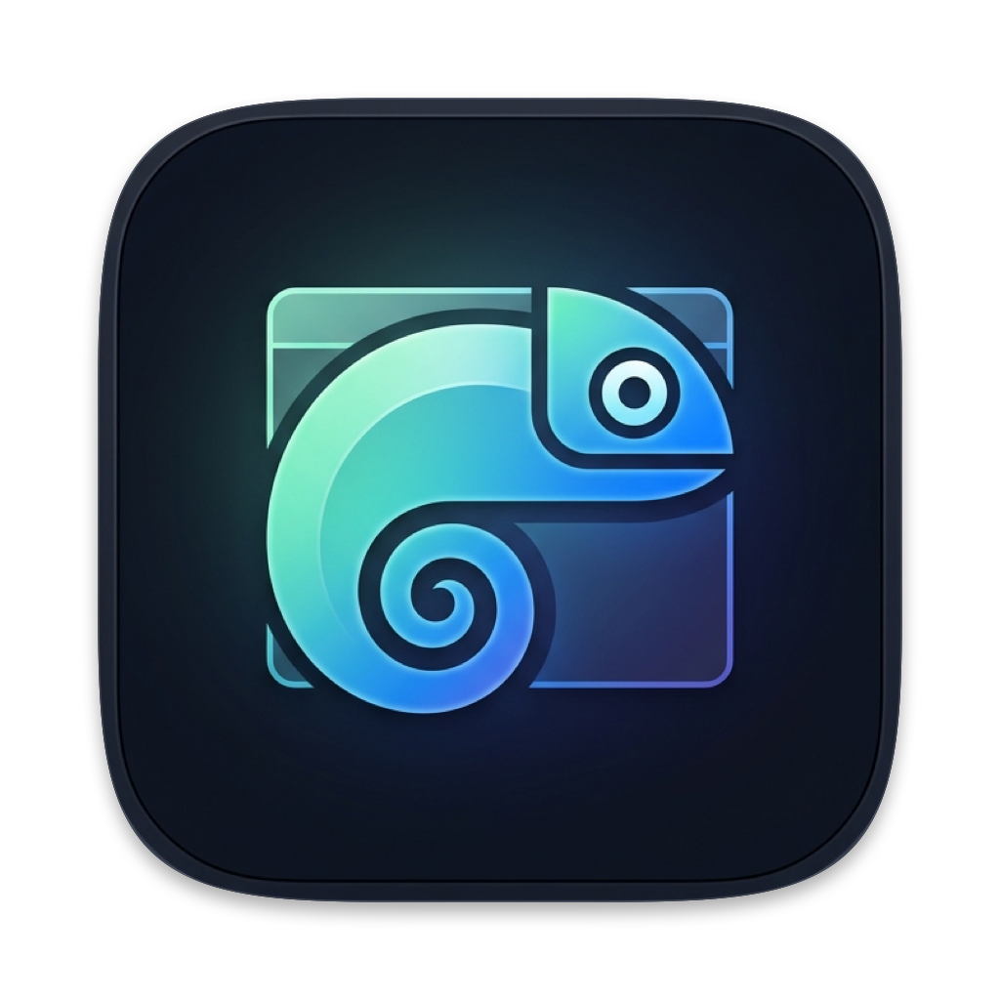
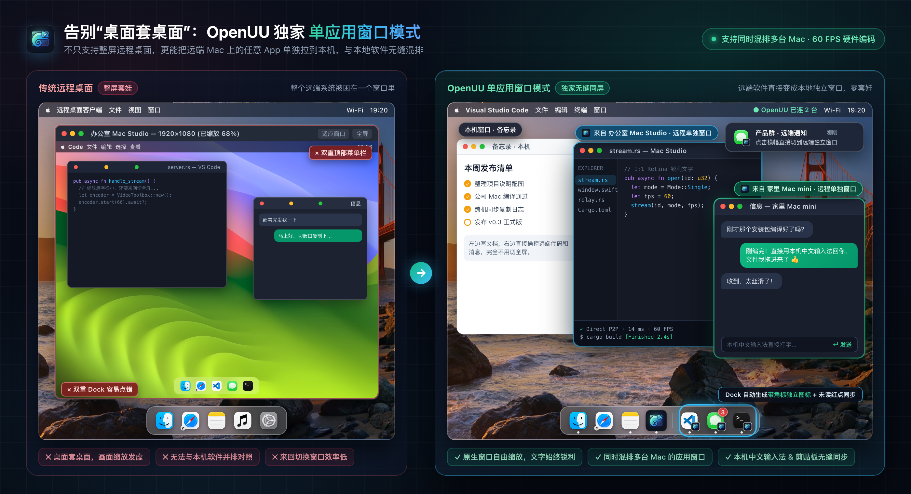
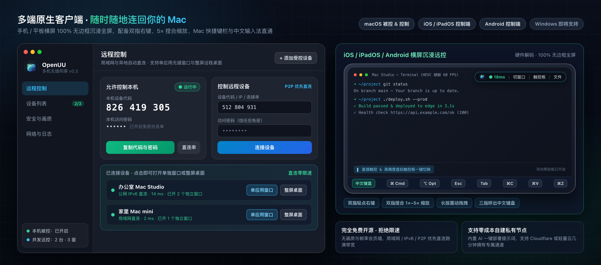

<p align="center">
  
</p>

<h1 align="center">OpenUU</h1>

<p align="center">
  <b>免费开源的远程控制工具 —— 不止远程桌面，更支持把远端 App 以「单独窗口」无缝拉到本机同屏使用</b>
</p>

<p align="center">
  <a href="https://github.com/onekb/OpenUU/releases/latest"></a>
  
  
  
  
  <a href="./LICENSE"></a>
  <a href="https://github.com/onekb/OpenUU/stargazers"></a>
</p>

<p align="center">
  <a href="#-下载安装与安全说明"><b>立即下载</b></a> ·
  <a href="#-什么是单应用窗口模式">独家单窗口模式</a> ·
  <a href="#-核心亮点">核心亮点</a> ·
  <a href="#-支持平台与路线图">支持平台</a> ·
  <a href="#-快速上手">快速上手</a> ·
  <a href="#-自建私有节点可选">自建节点</a> ·
  <a href="#-开发者与源码构建">源码构建</a>
</p>

<br />

<p align="center">
  
</p>

---

## ✨ 什么是「单应用窗口」模式？

用传统远程桌面时，哪怕你只想看一眼另一台电脑上的聊天消息、敲几行代码或查一个文件，也得把**整个远端桌面**套进一个大窗口里——双重顶部菜单栏、双重 Dock、画面缩成一团，和本机软件来回切换非常割裂。

**OpenUU 同时支持「整屏远程桌面」和独家「单应用窗口」模式：**

- **只拉你要用的那个窗口**：把公司或家里的 Mac / Windows 电脑上的任意 App（编辑器、终端、聊天软件、浏览器等）单独拉到本机桌面，和本地窗口并排使用，**彻底告别桌面套桌面**。
- **像本地软件一样自然**：拖拉窗口边缘即可实时同步缩放，文字始终保持高清锐利；本地中文输入法直接打字，剪贴板文字/图片/文件无缝双向同步，跨 Mac / Windows 智能映射 `Ctrl` 与 `⌘ Command` 快捷键。
- **远端声音同步 + 被控端自动静音**：无需安装第三方虚拟声卡，支持将远端单应用或整屏声音（48kHz 立体声 AAC-LC）实时传至控制端，并支持远控期间被控电脑自动静音（断开自动恢复外放）。
- **程序坞 / 任务栏独立图标 + 消息通知直达**：远端打开的 App 会在本机 macOS Dock 或 Windows 任务栏自动生成带 OpenUU 角标的独立图标，并实时同步未读红点与系统通知横幅——收到消息，点一下通知直接切回对应远端窗口。
- **多台电脑，一块屏幕**：支持同时连接多台 Mac 与 Windows 电脑，把不同机器上的窗口像拼图一样自由混排在你的主屏幕上。

---

## 🚀 核心亮点

### 1. 完全免费开源，拒绝画质与速度限制
- 无会员分级、无画质/帧率限制、无广告弹窗。
- 全端采用系统原生硬件编解码（最高支持 **60 FPS** 流畅画面），高速滚动时自动提速，静止时恢复 Retina 级清晰文字。

### 2. 局域网零配置，跨公网自动优选直连
- **同局域网**：打开即自动发现设备，零配置直连，毫秒级响应。
- **异地跨网**：自动按 **公网 IPv6 直连 → P2P 打洞直连 → 中继保底** 择优连接。只要能直连，数据直接点对点传输，跑满双方带宽。
- **多种连法**：支持 9 位设备码秒连，也支持直接复制 `openuu://` 连接串发给另一台设备即点即连；首次配对确认后加入信任列表，以后免密一键重连。

### 3. 手机 / 平板专业级远控体验
出门在外只带了手机或 iPad？OpenUU 为移动端打磨了克制、顺手的原生远控交互：
- **悬浮右键菜单 / 弹窗实时叠加**：独立解码并原位叠加微信右键菜单、表情面板、下拉菜单等子浮层（`kind=2`），在「单应用窗口」模式下也能直接点选菜单项。
- **新开窗口自动跳转 + 浏览器式窗口标签栏**：远端打开新窗口时自动聚焦切入，横屏全屏下主动短暂滑出顶部窗口标签栏（支持一键固定），关闭子窗口自动回退上一窗口。
- **清晰的关闭语义**：标签栏 `×` 仅关闭对应 Mac 窗口（`⌘W`），应用切换抽屉与会话菜单中的「断开远控连接」严格分离，杜绝误退。
- **100% 无边框沉浸全屏 + 全套多指手势**：横屏自动隐藏系统状态栏与导航条，支持「适应屏幕 / 铺满全屏」与「直接触控 / 虚拟触控板」切换、双指右键、捏合 `1×–5×` 缩放、长按拖拽、三指呼出中文键盘与 Mac 快捷键栏（`Cmd` / `Opt` / `Esc` / `⌘C` / `⌘V` 等），并支持相册/文件直传远端窗口。

### 4. 安全与隐私，完全掌握在自己手里
- 全程端到端加密传输，内置防爆破保护（连续输错密码自动临时封禁）与已信任设备白名单管理。
- 支持**后台虚拟副屏隔离与静默点击**，远控操作时尽量不打扰被控电脑主屏。
- 想独享满速带宽或完全私有化？可随时几分钟自建专属节点，App 内甚至自带 **AI 一键部署提示词**。

<br />

<p align="center">
  
</p>

---

## 📱 支持平台与路线图

| 平台 | 控制端（发起远控） | 被控端（允许被控） | 状态 |
| :--- | :---: | :---: | :--- |
| **macOS** | ✅ 支持 | ✅ 支持 | 已可用（支持单应用窗口 + 整屏桌面） |
| **Windows** | ✅ 支持 | ✅ 支持 | 已可用（Windows 10 / 11，支持单应用窗口 + 整屏桌面） |
| **iOS / iPadOS** | ✅ 支持 | — | 已可用（iPhone & iPad 原生硬解） |
| **Android** | ✅ 支持 | — | 已可用（手机 & 平板原生硬解） |

> 欢迎点击右上角 **Star ⭐** 支持项目持续迭代，更多平台（如 Linux 端）欢迎提交 Issue / PR 共建。

---

## 📥 下载安装与安全说明

前往 [**GitHub Releases**](https://github.com/onekb/OpenUU/releases/latest) 直接下载各平台安装包（附 `SHA256SUMS.txt` 校验值）：

| 平台 | 安装包 | 系统要求与说明 |
| :--- | :--- | :--- |
| **macOS (Apple Silicon / M 系列芯片)** | `OpenUU-*-macOS-arm64.dmg` | 控制端 + 被控端，需 macOS 14.0+ |
| **Windows (64 位)** | `OpenUU-*-Windows-x64.zip` | 控制端 + 被控端，需 Windows 10 / 11 (`x64`，免安装解压即用) |
| **Android (手机 / 平板)** | `OpenUU-*-Android-arm64.apk` | 控制端，需 Android 8.0+ (`arm64-v8a`) |
| **iOS / iPadOS** | `OpenUU-*-iOS-unsigned.ipa` | 控制端，需 iOS 17.0+，未签名 IPA（需自签安装） |

> **⚠️ 关于系统安全提示（必看）**  
> OpenUU 为个人发起的完全开源项目，**暂未购买 Apple Developer / Microsoft EV 代码签名与应用商店商业证书**，因此首次安装或打开时系统会弹出安全拦截提示，属正常现象。全部代码均在本仓库公开，有顾虑的朋友也可直接[从源码自行编译](#-开发者与源码构建)。

- **🪟 Windows 提示“Windows 已保护你的电脑 (Microsoft Defender SmartScreen)”**：  
  解压 `.zip` 后双击 `OpenUU.exe`，若弹出蓝色拦截窗口，点击 **「更多信息」** → **「仍要运行」** 即可直接启动（无需安装任何运行时依赖）。  
  > 作为 **被控端** 时无需额外系统权限即可开箱使用；若需远控操控目标机器上以「管理员身份」运行的软件窗口，可在「安全与画质」页点击 **「以管理员身份重启」**。

- **🍎 macOS 提示“已损坏，无法打开”或“无法验证开发者”**：  
  打开 `.dmg` 将 **OpenUU.app** 拖入 `应用程序 (Applications)` 后，打开终端执行一行命令解除浏览器下载隔离标记即可正常打开：
  ```bash
  xattr -cr /Applications/OpenUU.app
  ```
  > 也可在弹窗点「完成」后，进入 **系统设置 → 隐私与安全性** 页面底部点击 **「仍要打开」**。  
  > 首次开启 **被控模式** 时，需在「隐私与安全性」中授予 **屏幕录制**（捕获窗口画面）与 **辅助功能**（远程键鼠与输入法）两项权限。

- **🤖 Android 提示“未知来源”或安全风险提醒**：  
  因未上架各大应用商店，安装 `.apk` 时请在系统提示中选择 **「允许安装未知应用」** 或 **「了解风险并继续安装」**。

- **📱 iOS / iPadOS 安装方式**：  
  暂未上架 App Store，Releases 中提供的是**未签名 `.ipa`**，请使用 **AltStore / SideStore / Sideloadly / 爱思助手 / 巨魔商店 (TrollStore)** 自签安装（或直接拉取源码通过 Xcode 免费账号装到真机）。个人免费 Apple ID 自签需在「设置 → 通用 → VPN 与设备管理」信任证书，并每 7 天续签一次（TrollStore 无需续签）。

---

## ⚡ 快速上手

### 1. 同局域网直连（最简单）
1. 在被控的 Mac 或 Windows 电脑上打开 OpenUU，点击 **「开启被控」**（macOS 首次使用按提示授予「屏幕录制」和「辅助功能」权限；Windows 免配置即开即用）。
2. 在另一台 Windows、Mac、手机或平板上打开 OpenUU，点击局域网列表中发现的设备，输入访问密码即可连接。
3. 连上后，自由选择打开某个 **「单应用窗口」** 或进入 **「整屏桌面」**。

### 2. 异地跨公网连接
- **方式 A（9 位设备码秒连）**：被控端开启后直接展示本机 9 位设备码与访问密码，控制端输入即可跨网连接。
- **方式 B（连接串直连）**：被控端点击复制 `openuu://...` 直连串发给控制端，粘贴即可自动穿透直连。

<details>
<summary><b>👆 查看移动端（iOS / Android）手势速查表</b></summary>

<br />

| 手势 | 功能说明 |
| :--- | :--- |
| **单指轻点 / 双击** | 鼠标左键单击 / 双击打开 |
| **单指长按震动后拖动** | 按住左键拖拽（拖窗口、框选文字、拖文件，放大时同样可用） |
| **单指长按原地抬起 / 双指轻点** | 鼠标右键菜单 |
| **双指捏合 / 张开** | `1.0×` – `5.0×` 无极放大缩小与视野平移 |
| **双指平行上下滑** | 平滑滚轮滚动 |
| **三指轻点** | 呼出 / 收起系统中文软键盘与 Mac 快捷键栏 |
| **三指上下滑** | 显示 / 隐藏半透明悬浮快捷胶囊 |

</details>

---

## ☁️ 自建私有节点（可选）

OpenUU 开箱即可跨网使用；如果你希望**独享满速中继带宽**或把寻址/中继完全私有化，我们提供了两种极简方案：

1. **零成本方案（Cloudflare Workers + D1）**：免费额度充足、无需公网服务器，参考 [`deploy/cloudflare-worker/README.md`](./deploy/cloudflare-worker/README.md)。
2. **轻量云服务器一键 Docker 部署**：1 核 1G 轻量云即可流畅运行，参考 [`deploy/README.md`](./deploy/README.md)。
3. **懒人 AI 自动部署**：在 macOS 端打开 **「网络与日志」**，直接点击复制内置的 **AI 部署提示词**，发给 Claude Code / Cursor / Antigravity 等 AI 助手即可帮你全自动配好并输出填入参数。

---

## 🛠️ 开发者与源码构建

OpenUU 的核心传输与控制协议基于 Rust（`openuu-core`）跨平台共享，各端均采用原生 UI 与系统原生硬解码实现。

<details>
<summary><b>展开查看本地编译命令与仓库结构</b></summary>

### macOS 客户端 & 被控端
```bash
chmod +x scripts/build-macos.sh
./scripts/build-macos.sh
open ./build/OpenUU.app
```

### Windows 客户端 & 被控端
```powershell
powershell -ExecutionPolicy Bypass -File .\scripts\build-windows.ps1
.\build\OpenUU-Windows\OpenUU.exe
# 便携版压缩包产物：.\build\OpenUU-Windows-x64.zip
```

### Android 客户端
```bash
chmod +x scripts/build-android.sh
./scripts/build-android.sh
# 产物位置：./build/OpenUU-Android.apk（传入 --all-abis 可同时编译 arm64-v8a + x86_64）
```

### iOS / iPadOS 客户端
```bash
chmod +x scripts/build-ios.sh
./scripts/build-ios.sh
# 产物位置：./build/OpenUUMobile-iOS.app（真机）与 ./build/OpenUUMobile-Sim.app（模拟器）
```

### 目录说明
- `crates/openuu-core`：Rust 跨平台核心（五层自动兜底传输、TLS 1.3 + Ed25519 信道绑定鉴权）
- `crates/openuu-coord`：轻量级 9 位设备码寻址服务
- `crates/openuu-cli`：命令行连通性测试与调试工具
- `proto/openuu.proto`：跨平台 Protobuf v3 控制协议（H.264 / HEVC 双编码支持）
- `apps/macos`：macOS 原生 App（SwiftUI + AppKit + ScreenCaptureKit + VideoToolbox）
- `apps/windows`：Windows 原生客户端 & 被控端（.NET 8 WPF + Win32/DWM + DXGI + Media Foundation 硬编硬解）
- `apps/ios`：iOS / iPadOS 原生客户端（SwiftUI + UIKit + VideoToolbox）
- `apps/android`：Android 原生客户端（Kotlin + Jetpack Compose + MediaCodec）
- `deploy/`：Docker Compose 与 Cloudflare Workers 一键部署套件

</details>

---

## 💬 交流与反馈

如果 OpenUU 对你有帮助，欢迎点一个 **Star ⭐** 支持项目持续迭代！  
遇到问题或想要新功能，欢迎直接提 [Issue](https://github.com/onekb/OpenUU/issues) 或提交 PR。

---

## 📄 开源协议

本项目基于 [MIT License](./LICENSE) 开源协议发布。

